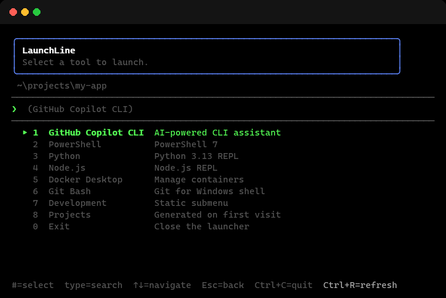
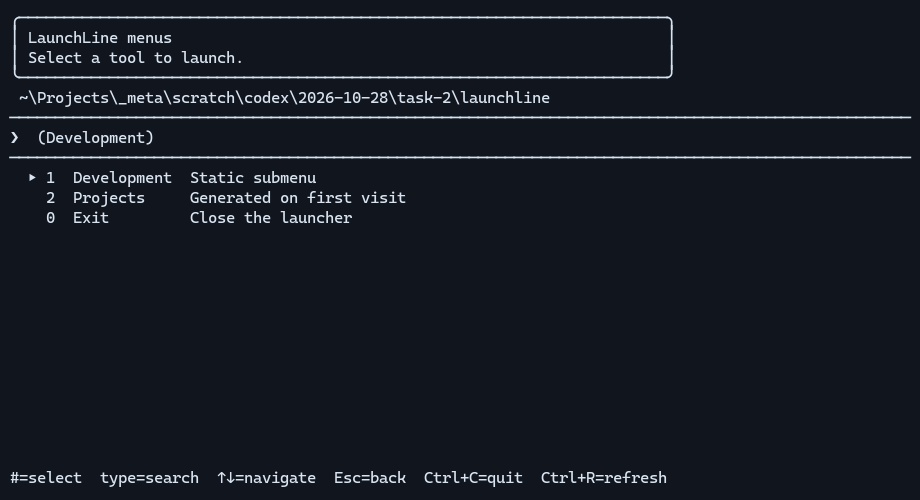

# LaunchLine

[](https://github.com/mikejhill/launchline/actions/workflows/ci.yml)
[](https://github.com/mikejhill/launchline/actions/workflows/release.yml)
[](https://pypi.org/project/launchline/)
[](https://pypi.org/project/launchline/)

A lightweight terminal launcher for interactive CLI tools. Define your frequently
used commands in a TOML config file, then pick them from a fuzzy-searchable menu
instead of remembering flags and paths.



Captured from the Python application in its own isolated terminal.
[Capture procedure and raw output](docs/images/captures/README.md).

## Why

Switching between CLI tools — AI assistants, shells, dev utilities — means
remembering commands, flags, working directories, and environment variables.
LaunchLine puts them all in one menu so you press a number or type a few letters
instead.

## Features

- **Nested and dynamic menus** - organize tools into submenus or generate them on demand
- **Fuzzy search** — type matching characters to narrow the list instantly
- **Numbered shortcuts** — press a digit to launch directly
- **Per-entry environment and working directory** — set once, forget forever
- **Auto-restart or exit** — configurable behavior after a tool exits
- **Zero runtime dependencies** — pure Python 3.12+, nothing to install beyond itself
- **Auto-generated starter config** — creates `~/.config/launchline/config.toml`
  on first run if no config exists

### Nested and generated menus



[Static submenu](docs/images/nested.png) · [Dynamic provider](docs/images/dynamic.png) ·
[Visual comparison and capture evidence](docs/images/captures/visual-review.md)

Images open at full resolution; each animation uses a single column to retain
readability on narrower screens.

## Installation

### From PyPI (recommended)

```sh
uv tool install launchline
```

Or with pip:

```sh
pip install launchline
```

### From source

```sh
git clone https://github.com/mikejhill/launchline.git
cd launchline
uv tool install .
```

### Run without installing

```sh
git clone https://github.com/mikejhill/launchline.git
cd launchline
uv sync --group dev
uv run launchline
```

## Quick Start

1. Run `launchline`. If no config exists, a starter config is created at
   `~/.config/launchline/config.toml`.
2. Edit the config to add your tools.
3. Run `launchline` again.

Override the config path:

```sh
# CLI flag (highest priority)
launchline --config ~/my-config.toml

# Environment variable
export LAUNCHLINE_CONFIG=~/my-config.toml
launchline
```

Resolution order: `--config` flag > `LAUNCHLINE_CONFIG` env var > default path.

## Configuration Reference

Config file format is [TOML](https://toml.io). The file has an optional
`[settings]` table and either nonempty `[[entries]]` or a root `[provider]`.

### `[settings]`

| Key                 | Type    | Default        | Description                                                       |
| ------------------- | ------- | -------------- | ----------------------------------------------------------------- |
| `title`             | string  | `"LaunchLine"` | Window/tab title shown while the launcher is active               |
| `on_exit`           | string  | `"restart"`    | Behavior after a launched tool exits: `restart` or `exit`         |
| `show_exit`         | bool    | `true`         | Show **Exit** (`0`) at root; submenus always show **Back** (`0`)                |
| `clear_on_launch`   | bool    | `true`         | Clear terminal before launching an entry                          |
| `ghost_text`        | bool    | `true`         | Show the highlighted entry name as an autocomplete hint on prompt |
| `numeric_trigger`   | bool    | `true`         | Pressing a digit immediately launches the matching entry          |
| `refresh_on_return` | boolean | `false`        | Regenerate a dynamic root after returning from a submenu          |

### `[[entries]]`

Each `[[entries]]` table defines a command or a submenu:

| Key                 | Type            | Required | Default | Description                                                    |
| ------------------- | --------------- | -------- | ------- | -------------------------------------------------------------- |
| `name`              | string          | yes      | —       | Display name shown in the menu                                 |
| `command`           | string          | leaf only | —       | Executable to run                                              |
| `args`              | list of strings | no       | `[]`    | Arguments passed to the command                                |
| `description`       | string          | no       | `""`    | Short description shown next to the name                       |
| `working_directory` | string          | no       | —       | Working directory for the subprocess                           |
| `env`               | table           | no       | `{}`    | Extra environment variables (`KEY = "value"`)                  |
| `id`                | string          | no       | `""`    | Stable per-menu identity for refreshed selection               |
| `menu`              | table           | no       | ------- | Submenu declaration, exclusive with command fields             |

### Validation Rules

- A root requires nonempty `[[entries]]` or a `[provider]` declaration.
- Every entry needs `name` and either `command` or `menu`.
- `on_exit` must be `"restart"` or `"exit"`.
- `args` must be a list (not a bare string).
- `env` must be a TOML table (not a string or list).
- If `working_directory` does not exist at load time, it is silently reset to
  `None` (a warning is logged).

### Example Config

```toml
[settings]
title = "My Tools"
on_exit = "restart"
show_exit = true
clear_on_launch = true
ghost_text = true
numeric_trigger = true

[[entries]]
name = "GitHub Copilot CLI"
command = "copilot"

[[entries]]
name = "Claude Code"
command = "claude"
description = "Anthropic coding agent"
working_directory = "~/projects"

[[entries]]
name = "PowerShell"
command = "pwsh"
args = ["-NoProfile"]
env = { TERM = "xterm-256color" }
```

### Nested and dynamic menus

Run the checked-in example from the repository root:

```sh
launchline --config examples/menu-demo.toml
```

The provider example uses `python`; set its `command` to your Python executable
if needed. Both implementations accept this same configuration:

```toml
[settings]
title = "LaunchLine menus"

[[entries]]
name = "Development"
description = "Static submenu"
[entries.menu]
title = "Development tools"
[[entries.menu.entries]]
name = "Git version"
command = "git"
args = ["--version"]

[[entries]]
id = "projects"
name = "Projects"
description = "Generated on first visit"
[entries.menu]
title = "Project tools"
refresh_on_return = true
[entries.menu.provider]
command = "python"
args = ["examples/menu_provider.py"]
timeout_seconds = 10
```

The [example provider](examples/menu_provider.py) prints UTF-8 JSON such as:

```json
{"entries":[{"id":"git","name":"Git status","command":"git","args":["status"]}]}
```

Providers run only when their menu is first opened or refreshed. `Ctrl+R` or the
Refresh/Retry row regenerates the current dynamic menu. `refresh_on_return`
refreshes that menu when returning from a child submenu, not from a command.
Back preserves the parent query and selection. `Escape` clears a query first,
then returns to the parent (or exits at root). In every submenu, `0` returns
exactly one level, even during search; no numbered row quits the launcher.
At root, `0` remains Exit when `show_exit` is enabled. `Ctrl+C` quits immediately
from any depth.

A submenu entry cannot also declare `command`, `args`, `env` or
`working_directory`. Each menu has either `entries` or `provider`. For a dynamic
root, replace the root entries with `[provider]` using the same fields.
Providers are trusted executables, invoked with literal argv and closed stdin;
`--check-config` validates declarations without running them. See the
[full contract](docs/menus.md) for provider environment/working directory,
timeouts, caching, limits and failure/retry behavior.

## Usage

| Key           | Action                                    |
| ------------- | ----------------------------------------- |
| `1`–`9`       | Launch entry by number                    |
| `0`           | Back one level in submenus; Exit at root when enabled |
| Type any text | Fuzzy-filter the entry list               |
| `Up` / `Down` | Move highlight                            |
| `Enter`       | Launch highlighted entry                  |
| `Escape`      | Clear filter, then Back (exit at root)     |
| `Ctrl+R`      | Refresh the current dynamic menu           |
| `Backspace`   | Delete last character from filter         |
| `Ctrl+U`      | Clear filter                              |

## Windows Terminal Integration

Add LaunchLine as a Windows Terminal profile to use it as your default launcher.
The package bundles an icon that you can reference via `launchline --icon-path`:

```jsonc
// In your Windows Terminal settings.json → profiles.list
{
  "name": "LaunchLine",
  "commandline": "launchline",
  "startingDirectory": "%USERPROFILE%",
  // Run: launchline --icon-path
  "icon": "C:/Users/you/.local/lib/.../launchline/assets/launchline.ico"
}
```

Set it as the default profile to see the launcher every time you open a terminal.

## Development

Mutation campaigns run asynchronously on the default branch. See
[mutation policy, results and durable alerts](docs/mutation-testing.md).

```sh
uv sync --locked --group dev
uv run poe check-fast
uv run poe check
uv run poe release-check
```

See [performance validation](docs/performance.md) for gate scope, reproducible
benchmarks, measured results and regression checks.

## License

MIT

## See Also

- **[LaunchLine (Rust)](https://github.com/mikejhill/launchline-rust)** — a Rust
  implementation with the shared configuration and keyboard contract,
  ships as a single native binary.

## Compatibility and validation

Use `launchline --check-config` to validate configuration without opening the menu.
Set `NO_COLOR` for a selection marker without ANSI color. See the
[compatibility matrix](docs/compatibility.md), [reproducible test and performance
results](docs/validation/report.md), and [release readiness](docs/releasing.md).

### `[provider]`

The same table is accepted under `entries.menu.provider`. See the
[menu lifecycle and provider contract](docs/menus.md) for nesting, caching,
refresh/back behavior, limits, errors and examples.

| Field               | Type         | Default   | Description                          |
| ------------------- | ------------ | --------- | ------------------------------------ |
| `command`           | string       | required  | Explicit trusted provider executable |
| `args`              | string array | `[]`      | Literal argv                         |
| `env`               | string table | `{}`      | Environment overlay                  |
| `working_directory` | string       | inherited | Provider working directory           |
| `timeout_seconds`   | integer      | `10`      | Deadline from 1 to 300 seconds       |
