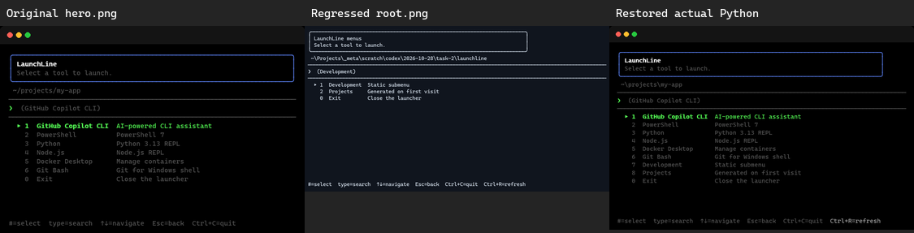

# Visual restoration review

The original `demo.gif` and `hero.png` were compared with the regressed root
screenshot and the restored runtime captures by viewing actual pixels and decoded
GIF frames. The original assets and `tools/generate_screenshots.py` are preserved;
the measurements tool checks the original hero/demo bytes against the baseline
commit recorded by each capture manifest.

The regression discarded ANSI foreground/background and bold, replaced the
original black/CGA theme and terminal chrome with a monochrome image, widened
the terminal to 100 columns, and replaced six tool options with two menu entries.
The restoration reuses the original pixel renderer and font/palette/spacing,
retains all six original tools, and adds Development and Projects. Header,
borders, bright-green selection, dim descriptions, fuzzy-query highlights,
Back/Refresh/Exit options and the full Ctrl+R footer are visible without cropping.

Both native runtimes ran independently in owned ConPTY fixtures. All UI content
comes from their own ANSI output; only the original presentation renderer is
shared. Rust's Windows home-directory API resolves the real profile rather than
the child USERPROFILE override, so its actual temporary working path differs
from Python's. No path or other text was rewritten in the images. No leaf command,
desktop input, clipboard or hooks were exercised.

## Animation inspection

[Every original demo frame](../review/demo-frames.png),
[every restored launcher frame](../review/launcher-frames.png), and
[every restored menu frame](../review/menus-frames.png) are provided as labeled
contact sheets. All were visually inspected, including root, incremental search,
query clearing, arrow navigation, static submenu, returned root and generated
provider states. No blank/transient screens, missing glyphs, clipped borders or
cropped options were observed.

| Animation | Geometry | Actual GIF frames | Timing |
| --- | --- | --- | --- |
| Original demo | 688 x 468 | 10 | 5.35 seconds |
| Restored launcher | 760 x 508 | 6 | 5.75 seconds; 350ms typing, 1.2–1.6s reading pauses |
| Restored menus | 760 x 508 | 4 | 8 seconds; submenu/provider reading pauses |

The menu capture includes a real Ctrl+R refresh; its unchanged provider output
produces an identical final frame, which GIF encoding combines with the preceding
provider frame into a 3.4-second hold. The separate refreshed PNG and raw checkpoint
remain available. Detailed durations are in [measurements.json](../review/measurements.json).

## Narrow-screen review

These previews preserve aspect ratio. The green selected item remains distinct;
small gray descriptions need the full-resolution image at this width, as in the
original. README animations now occupy one column, with full-size static links,
rather than shrinking two screenshots into adjacent table cells. The 80-column
layout retains the entire refresh hint; 22 rows accommodate the two added options
while keeping the original font size and vertical spacing.

Rebuild the comparison sheets from the retained baseline and current captures:
`python tools/review_visuals.py` (Pillow required). This is a pixel/frame review of
Windows terminal output; it does not claim native desktop or other-platform UI
validation. An independent reviewer can inspect every linked frame and the raw
captures without relying on asset hashes alone.
